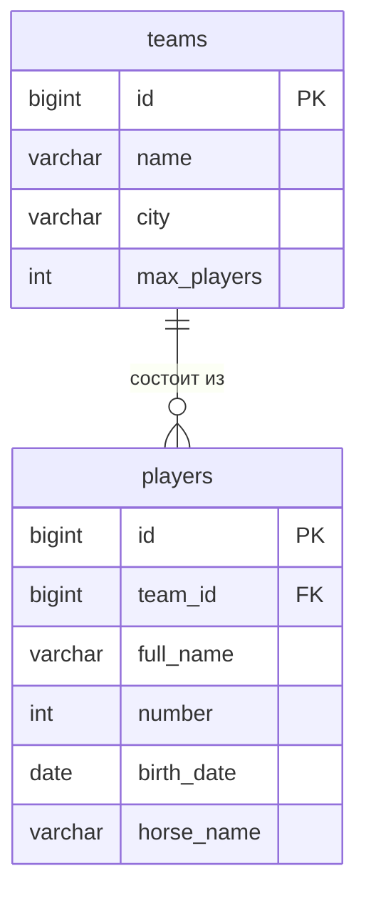

# Название проекта

Тема №29: **Спортивная лига**. Одна фраза: Сервис учёта команд любительской лиги по хоббихорсингу и их составов для организаторов лиг, капитанов команд и болельщиков.

| | |
| --- | --- |
| Главная сущность | Команда |
| Связанная сущность (1:N) | Игрок |
| Фишка | Правила лиги: в составе не больше N игроков, номера не повторяются |
| Стек | java 25, Spring Boot 4.1.1, PostgreSQL |

## Как запустить

```bash
git clone https://github.com/rhinci/backend_lupanova_league.git
cd backend_lupanova_league
./mvnw spring-boot:run
```

Сервис работает на `http://localhost:8000`. Запросы для демонстрации лежат в `requests.http`. Данные хранятся в памяти и пропадают при перезапуске. Запросы для демонстрации лежат в `requests.http`.

Документация API (Swagger UI): `http://localhost:8000/docs`.

## Эндпоинты

| Метод | Путь | Что делает | Ответ |
| --- | --- | --- | --- |
| GET | `/health` | Проверка, что сервис жив | 200 `{"status":"ok"}` |
| POST | `/api/teams` | Создать | 201 и объект с `id`; 400 при ошибке |
| GET | `/api/teams` | Список | 200 |
| GET | `/api/teams/{id}` | Получить одну запись | 200; 404 |
| PATCH | `/api/teams/{id}` | Изменить | 200; 400; 404 |
| DELETE | `/api/teams/{id}` | Удалить | 204; 404 |
| POST | `/api/teams/{id}/players` |	Добавить игрока в команду	| 201; 400; 404; 409 |
| GET |	`/api/teams/{id}/players` |	Список игроков команды | 200; 404 |

## Фильтр и пагинация

`GET /api/teams?city=Москва&limit=10&offset=0`

| Параметр | Что делает |
| --- | --- |
| `city` | Только команды из этого города (регистр не важен) |
| `limit` | Сколько записей вернуть, не меньше 1; по умолчанию без ограничения |
| `offset` | Сколько записей пропустить с начала, не меньше 0; по умолчанию 0 |

## ER-диаграмма



## Интерфейс

<!-- С лабы 4: скриншот, например  -->
