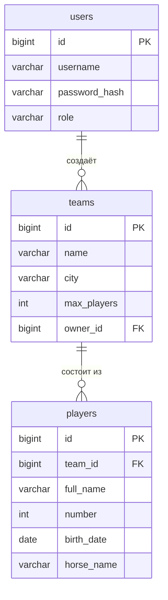

# Название проекта

Тема №29: **Спортивная лига**. Одна фраза: Сервис учёта команд любительской лиги по хоббихорсингу и их составов для организаторов лиг, капитанов команд и болельщиков.

| | |
| --- | --- |
| Главная сущность | Команда |
| Связанная сущность (1:N) | Игрок |
| Фишка | Правила лиги: в составе не больше N игроков, номера не повторяются |
| Стек | java 25, Spring Boot 4.1.1, PostgreSQL, bcrypt, JWT |

## Как запустить

Нужны Java 25 и Docker.

```bash
git clone https://github.com/rhinci/backend_lupanova_league.git
cd backend_lupanova_league
```

1. Запустить PostgreSQL в Docker:

```bash
docker run --name league-db -e POSTGRES_USER=league_user -e POSTGRES_PASSWORD=league_pass -e POSTGRES_DB=league -p 5433:5432 -v league-pgdata:/var/lib/postgresql/data -d postgres:17
```

2. Создать файл `.env` из шаблона и при необходимости поменять значения:

```bash
cp .env.example .env
```

В PowerShell вместо `cp` можно использовать `Copy-Item .env.example .env`. Для базы из команды выше нужно заменить в `.env` значение `DB_PASSWORD=change_me` на `DB_PASSWORD=league_pass`.
В `.env` также задаются `JWT_SECRET` (случайная строка от 32 символов, сгенерировать можно командой
`[Convert]::ToBase64String((1..48 | ForEach-Object { Get-Random -Maximum 256 }))` в PowerShell),
`JWT_TTL_MINUTES` (время жизни токена в минутах) и `ADMIN_USERNAME` / `ADMIN_PASSWORD`
(администратор создаётся при старте сервиса).

3. Запустить сервис:

```bash
./mvnw spring-boot:run
```

Сервис работает на `http://localhost:8000`. Схема базы создаётся автоматически при старте миграциями Flyway из папки `src/main/resources/db/migration`. Данные хранятся в PostgreSQL и переживают перезапуск сервиса. Запросы для демонстрации лежат в `requests.http`.

Тестовые данные (500 команд и 5000 игроков, сиды) заливаются одной командой, запуском сервиса с профилем `seed`:

```bash
./mvnw spring-boot:run "-Dspring-boot.run.profiles=seed"
```

Документация API (Swagger UI): `http://localhost:8000/docs`.

## Эндпоинты

| Метод | Путь | Что делает | Ответ |
| --- | --- | --- | --- |
| GET | `/health` | Проверка, что сервис жив | 200 `{"status":"ok"}` |
| POST | `/api/teams` | Создать | 201 и объект с `id`; 400 при ошибке |
| GET | `/api/teams` | Список | 200 |
| GET | `/api/teams/{id}` | Получить одну запись | 200; 404 |
| PATCH | `/api/teams/{id}` | Изменить | 200; 400; 404 |
| DELETE | `/api/teams/{id}` | Удалить | 204; 404 |
| POST | `/api/teams/{id}/players` |	Добавить игрока в команду	| 201; 400; 404; 409 |
| GET |	`/api/teams/{id}/players` |	Список игроков команды | 200; 404 |
| GET | `/api/teams/stats` | Статистика: число игроков и средний возраст по командам | 200 |
| POST | `/auth/register` | Регистрация | 201; 400; 409 |
| POST | `/auth/login` | Вход, выдаёт `access_token` (JWT) | 200; 400; 401; 429 |
| GET | `/auth/me` | Текущий пользователь | 200; 401 |

## Пользователи и доступ

- Читать данные (`GET`) может кто угодно. Изменять (`POST`, `PATCH`, `DELETE`) может только вошедший.
- Вход двумя способами: `Authorization: Basic <логин:пароль в Base64>` или
  `Authorization: Bearer <JWT>` (токен выдаёт `POST /auth/login`).
- Пароли хранятся хэшем bcrypt. Секрет и срок жизни JWT берутся из `.env`.
- Автора записи (`ownerId`) ставит сервер. Чужую команду, а также игроков в ней, изменить и удалить нельзя: 403.
- Роль `admin` может менять и удалять любые записи. Админ создаётся при старте из `ADMIN_USERNAME` / `ADMIN_PASSWORD`,
  через регистрацию стать админом нельзя.
- После 5 неудачных попыток входа за минуту сервер отвечает 429 (счётчик в памяти сервиса).

## Фильтр и пагинация

`GET /api/teams?city=Москва&limit=10&offset=0`

| Параметр | Что делает |
| --- | --- |
| `city` | Только команды из этого города (регистр не важен) |
| `limit` | Сколько записей вернуть, не меньше 1; по умолчанию без ограничения |
| `offset` | Сколько записей пропустить с начала, не меньше 0; по умолчанию 0 |
| `q` | Поиск по названию команды, регистр не важен, ищет база |


## Индекс и EXPLAIN

Самый частый запрос сервиса: список игроков команды (`GET /api/teams/{id}/players`). Он ищет по `team_id`, а PostgreSQL сам не создаёт индекс на внешний ключ. Индекс добавлен миграцией `V2__index_players_team_id.sql`:

```sql
CREATE INDEX idx_players_team_id ON players (team_id);
```

Проверка на базе с тестовыми данными (500 команд, 5000 игроков):

```sql
EXPLAIN ANALYZE SELECT * FROM players WHERE team_id = 250;
```

До индекса база читает всю таблицу:

```
Seq Scan on players  (cost=0.00..118.50 rows=10 width=55) (actual time=0.290..0.498 rows=10 loops=1)
  Filter: (team_id = 250)
  Rows Removed by Filter: 4990
Execution Time: 0.630 ms
```

После индекса база использует его:

```
Index Scan using idx_players_team_id on players  (cost=0.28..8.46 rows=10 width=55) (actual time=0.052..0.055 rows=10 loops=1)
  Index Cond: (team_id = 250)
Execution Time: 0.125 ms
```

## ER-диаграмма



## Интерфейс

<!-- С лабы 4: скриншот, например  -->
